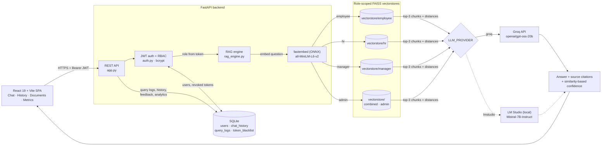
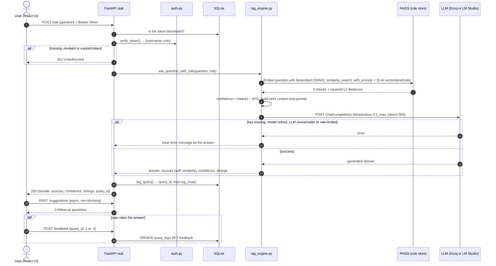
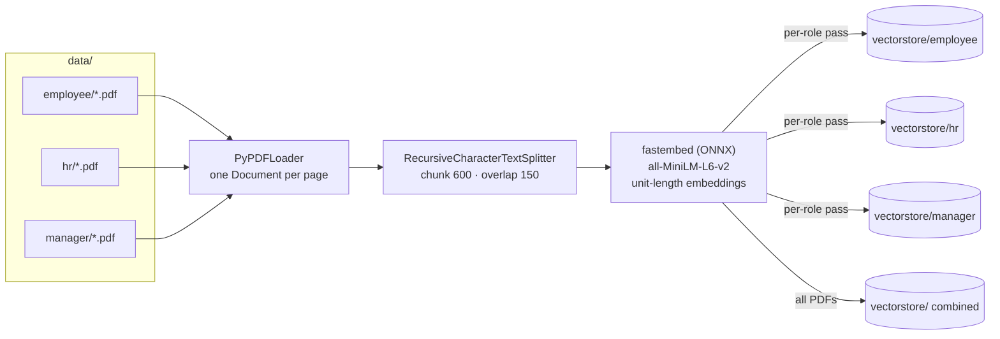
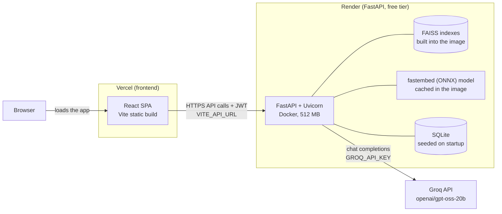

# Enterprise RAG Assistant

**A role-aware AI assistant that answers company-policy questions strictly from the documents each user is allowed to see, and cites every source.**


## Try it now

**Live demo:** [enterprise-rag-assistant-silk.vercel.app](https://enterprise-rag-assistant-silk.vercel.app)
**API docs:** [enterprise-rag-assistant-d172.onrender.com/docs](https://enterprise-rag-assistant-d172.onrender.com/docs)

Sign in with one of the demo accounts and pick the matching role on the login screen. Each role sees a different set of documents.

| Username | Password | Role to pick on the login screen |
|---|---|---|
| `john` | `password123` | Employee (`employee`) |
| `alice` | `password123` | HR Manager (`hr`) |
| `bob` | `password123` | Department Manager (`manager`) |
| `admin` | `admin123` | Administrator (`admin`) |

> The backend runs on Render's free tier. If it has been idle, the first request can take around a minute while it wakes up; the app shows a banner until it's ready. These are public demo credentials, so don't enter anything sensitive.

---

## Key features

- **Role-based retrieval.** Each role has its own FAISS index, so an employee cannot retrieve HR or manager documents. Admins search a combined index.
- **Grounded answers.** A strict prompt tells the LLM to answer only from the retrieved context. If the answer isn't there, it replies with a fixed "I don't have information about this…" message.
- **Source citations.** Every answer lists its source chunks (file name, page, snippet, similarity), with **View** and **Download** links to the original document.
- **Real confidence scores.** Confidence is the mean cosine similarity between the question and the retrieved chunks. On-topic questions score about 0.5–0.7; off-topic ones about 0.05–0.12.
- **Choice of LLM provider.** [Groq](https://groq.com/) (hosted, default model `openai/gpt-oss-20b`) or a local [LM Studio](https://lmstudio.ai/) server, switched with one environment variable.
- **Feedback, suggestions and analytics.** Users rate answers 👍/👎, get three role-aware follow-up questions, and can open a Recharts dashboard. It shows answer rate, confidence distribution, top questions and latency.
- **Streaming endpoint.** `POST /ask-stream` sends sources, confidence and answer tokens as Server-Sent Events with either provider.
- **Chat UI extras.** Role-specific quick questions, voice input (Web Speech API), chat export to `.txt` and a clear-chat button.

## Key engineering decisions

- **Role-isolated FAISS indexes.** Access control happens at retrieval time, not in the prompt. Each role has its own index, so documents a user may not see are never retrieved and can't leak into an answer. Admins use a combined index.
- **Similarity-based confidence.** The confidence score comes from retrieval, not from the LLM's opinion of itself. The embeddings are unit-length and FAISS returns squared L2 distance *d²*, so each chunk's cosine similarity is *1 − d²/2*. Confidence is the mean over the retrieved chunks.
- **Provider switch (Groq or LM Studio).** Both speak the OpenAI chat-completions format, so `LLM_PROVIDER` switches between hosted Groq and a fully local LM Studio. Missing keys, retired models and rate limits come back as clear messages instead of crashes.
- **bcrypt + JWT authentication.** Passwords are hashed with bcrypt. Older SHA-256 hashes are upgraded on the next login. Logins return HS256 JWTs carrying the user's role, signed with a secret from the environment, and logout revokes the token through a blacklist.
- **fastembed (ONNX) instead of PyTorch.** `all-MiniLM-L6-v2` runs on ONNX Runtime and produces the same vectors without the PyTorch stack. The image shrank from 2.66 GB to 1.15 GB, and the API peaks at about 220 MiB of RAM, comfortably inside Render's 512 MB free tier.

---

## How it works

1. **Ingestion (offline, or at Docker build).** `ingest_documents.py` loads the PDFs in `data/<role>/` and splits them into 600-character chunks with 150 characters of overlap. It embeds the chunks with `all-MiniLM-L6-v2` via fastembed (ONNX) and saves one FAISS index per role, plus a combined index for admins.
2. **Login.** The user signs in with a username, password and role. The backend checks the bcrypt hash in SQLite and returns a JWT that carries the user's `role`.
3. **Retrieval.** On `POST /ask`, the backend reads the role from the token. It embeds the question with the same fastembed model and searches that role's FAISS index for the top 3 chunks, with their distances.
4. **Confidence.** Each chunk's distance is converted to a cosine similarity, and the answer's confidence is their mean.
5. **Generation.** The chunks are placed in a strict "context-only" prompt and sent to the configured LLM provider at temperature 0.1 with a 500-token limit. For gpt-oss reasoning models, `reasoning_effort` is set to `low`.
6. **Response.** The API returns the answer with its sources, confidence and timings. It logs the exchange to SQLite and returns a `query_id` that the UI uses for feedback.

### Architecture



### One `/ask` request



### Document ingestion (separate flow)

Ingestion runs once locally, or inside `docker build`, so the deployed image ships with ready-made indexes.



---

## Tech stack

| Layer | Technology |
|---|---|
| Frontend | React 19, Vite 8, Tailwind CSS 3, React Router 7, Zustand, Axios, Recharts, react-hot-toast |
| Backend | FastAPI, Uvicorn, Pydantic, python-dotenv |
| RAG pipeline | LangChain (`langchain-community`, `langchain-text-splitters`), PyPDFLoader / pypdf |
| Embeddings | `all-MiniLM-L6-v2` via fastembed (ONNX Runtime) |
| Vector store | FAISS (`faiss-cpu`), one index per role plus a combined index |
| LLM | Groq (`openai/gpt-oss-20b` by default) or LM Studio (local, e.g. Mistral-7B-Instruct) |
| Auth | PyJWT (HS256), passlib + bcrypt, SQLite token blacklist |
| Storage | SQLite (users, chat history, query logs, feedback) |
| Hosting | Vercel (frontend), Render free tier (Docker backend), Groq (LLM) |

---

## Role-based access

Each role searches **only its own index**. The roles are isolated, not hierarchical: HR and managers do not search employee documents. Only admins search everything.

| Role | Demo user | FAISS index searched | Documents it can see |
|---|---|---|---|
| `employee` | `john` | `vectorstore/employee` | Attendance Policy, Employee Code of Conduct, HR Leave Policy, Working-from-Home Policy |
| `hr` | `alice` | `vectorstore/hr` | Recruitment & Selection Policy, Recruitment Policy, Payroll Policy¹ |
| `manager` | `bob` | `vectorstore/manager` | Employee Performance Review Policy, Promotion Policy |
| `admin` | `admin` | `vectorstore/` (combined) | All of the above |

¹ `payroll-policy.docx` appears in HR's document list and can be downloaded. It isn't indexed yet because ingestion only reads PDFs (see [Roadmap](#roadmap)).

Roles also control access to the API:

| Capability | employee | manager | hr | admin |
|---|:-:|:-:|:-:|:-:|
| Chat, suggestions, feedback, own history | ✅ | ✅ | ✅ | ✅ |
| `/analytics/stats` | own role | own role | own role | all roles |
| `/analytics/activity` | own queries | own queries | all users | all users |
| `/analytics/performance` | ❌ | ❌ | ✅ | ✅ |
| `/admin/*` (create/list users, detailed stats) | ❌ | ❌ | ❌ | ✅ |

---

## Project structure

```
enterprise-rag-assistant/
├── backend/
│   ├── app.py               # FastAPI app: routes, CORS, auth dependency, static /documents mount
│   ├── config.py            # Loads backend/.env; paths, LLM provider, CORS, JWT secret, embedding cache
│   ├── embeddings.py        # fastembed all-MiniLM-L6-v2, shared by ingestion and querying
│   ├── auth.py              # JWT issue/verify, login, password change, token blacklist
│   ├── security.py          # bcrypt password hashing (passlib)
│   ├── rag_engine.py        # Role-based retrieval, confidence, Groq/LM Studio client, streaming, suggestions
│   ├── ingest_documents.py  # Builds the per-role and combined FAISS indexes from data/
│   ├── database.py          # SQLite schema + demo-user seeding on startup
│   ├── analytics.py         # Query/chat logging, feedback, stats and evaluation metrics
│   ├── test_rag.py          # Small interactive CLI for querying the RAG engine
│   └── .env.example         # Template for backend/.env
├── frontend-react/          # React + Vite + Tailwind UI
│   ├── src/
│   │   ├── api/             # Axios client (JWT interceptor) and API_BASE from VITE_API_URL
│   │   ├── store/           # Auth state and server wake-up state (Zustand)
│   │   ├── pages/           # Login, Dashboard
│   │   └── components/      # chat/, layout/ (incl. ServerWakeBanner), views/
│   ├── vercel.json          # SPA rewrite so deep links like /login work on refresh
│   └── .env.example
├── data/                    # Policy documents, one folder per role
├── vectorstore/             # Generated by ingest_documents.py (git-ignored)
├── docs/                    # Detailed guides (API, workflow, testing, roadmap)
├── Dockerfile               # Backend image for Render (listens on $PORT, default 10000)
├── render.yaml              # Render Blueprint: free Docker web service
├── .dockerignore
├── requirements.txt
└── LICENSE
```

---

## Local setup

### Prerequisites

- **Python 3.11** and **Node.js 20.19+**
- A free **[Groq API key](https://console.groq.com/keys)**, or **[LM Studio](https://lmstudio.ai/)** with a model loaded if you prefer to run the LLM locally

### 1. Clone and install the backend

<details open>
<summary><b>Windows (PowerShell)</b></summary>

```powershell
git clone https://github.com/GOPIKA-BTECH23/enterprise-rag-assistant.git
cd enterprise-rag-assistant

python -m venv .venv
.venv\Scripts\Activate.ps1          # cmd.exe: .venv\Scripts\activate.bat
pip install -r requirements.txt

Copy-Item backend\.env.example backend\.env
```

If PowerShell blocks the activation script, run `Set-ExecutionPolicy -Scope CurrentUser RemoteSigned` once.
</details>

<details open>
<summary><b>macOS / Linux</b></summary>

```bash
git clone https://github.com/GOPIKA-BTECH23/enterprise-rag-assistant.git
cd enterprise-rag-assistant

python3 -m venv .venv
source .venv/bin/activate
pip install -r requirements.txt

cp backend/.env.example backend/.env
```
</details>

### 2. Configure the LLM

Edit `backend/.env` (see [Environment variables](#environment-variables)):

- **Groq (default):** set `GROQ_API_KEY` and a long random `JWT_SECRET`.
- **LM Studio (fully local):** set `LLM_PROVIDER=lmstudio`. In LM Studio, load a model and start the local server on port 1234. If your model isn't `mistral-7b-instruct-v0.2@q4_0`, set `LLM_MODEL` to its identifier.

If `GROQ_API_KEY` is missing, the API still starts. Chat answers then explain that the key is missing instead of failing silently.

### 3. Build the vector indexes

```bash
python backend/ingest_documents.py
```

Paths are resolved relative to the code, so this works from any directory. The first run downloads the ONNX embedding model (about 90 MB) into `.fastembed_cache/`. Re-run it, then restart the API, whenever you change the documents in `data/`.

### 4. Run the API

```bash
cd backend
uvicorn app:app --reload --port 8000
```

The SQLite database and demo users are created on first start. Interactive API docs are at **http://127.0.0.1:8000/docs**.

### 5. Run the frontend

```bash
cd frontend-react
npm install
npm run dev
```

Open **http://localhost:5173** and sign in with one of the [demo accounts](#try-it-now). The frontend talks to `http://127.0.0.1:8000` by default. To point it elsewhere, copy `.env.example` to `.env` and set `VITE_API_URL`.

### Optional: run the production image locally

```bash
docker build -t enterprise-rag-backend .
docker run --rm -p 10000:10000 --memory=512m \
  -e GROQ_API_KEY=your-key -e JWT_SECRET=some-long-random-string \
  -e CORS_ORIGINS=http://localhost:5173 \
  enterprise-rag-backend
```

Then start the frontend with `VITE_API_URL=http://127.0.0.1:10000`.

---

## Environment variables

### Backend: `backend/.env` locally, Render **Environment** settings when deployed

Real environment variables take precedence over `backend/.env`.

| Variable | Default | Required | Description |
|---|---|---|---|
| `LLM_PROVIDER` | `groq` | | `groq` (hosted) or `lmstudio` (local) |
| `GROQ_API_KEY` | none | with Groq | Groq API key. **Keep secret.** |
| `LLM_MODEL` | `openai/gpt-oss-20b` (groq) / `mistral-7b-instruct-v0.2@q4_0` (lmstudio) | | Model name sent to the provider. If the model is retired or unknown, answers tell you to change this. |
| `LM_STUDIO_URL` | `http://127.0.0.1:1234/v1/chat/completions` | | LM Studio endpoint (only with `lmstudio`) |
| `JWT_SECRET` | random per process in dev | in production | Signs login tokens. Without it, the app refuses to start in production; in dev, logins reset on every restart. **Keep secret.** |
| `CORS_ORIGINS` | `http://localhost:5173,http://127.0.0.1:5173` | | Comma-separated frontend origins allowed to call the API |
| `APP_ENV` | none (`production` in the Docker image) | | `production` makes a missing `JWT_SECRET` a startup error. Also implied on Render, which sets `RENDER=true`. |
| `DB_PATH` | `backend/enterprise_rag.db` | | SQLite file location |
| `FASTEMBED_CACHE_PATH` | `.fastembed_cache/` in the repo root | | Where the embedding model is cached (pre-filled inside the Docker image) |
| `PORT` | `10000` | | Port the Docker image listens on. Render sets it automatically. |

### Frontend: `frontend-react/.env` locally, Vercel **Environment Variables** when deployed

| Variable | Default | Description |
|---|---|---|
| `VITE_API_URL` | `http://127.0.0.1:8000` | Backend base URL. Read at **build time**, so redeploy after changing it. |

Retrieval and generation settings (`RETRIEVAL_K = 3`, `TEMPERATURE = 0.1`, `MAX_TOKENS = 500`, chunk size 600/150) are constants in `backend/rag_engine.py` and `backend/ingest_documents.py`.

---

## Deployment

The React frontend runs on **Vercel**, the FastAPI backend on **Render's free tier** (Docker), and answers are generated by **Groq**.



### 1. Backend → Render

1. Sign in to [Render](https://render.com) with GitHub and choose **New → Blueprint**. Select this repository; Render reads `render.yaml`, which describes a free Docker web service with health check `/health`.
2. When prompted, fill in the values marked `sync: false`:
   - `GROQ_API_KEY`: your Groq key
   - `JWT_SECRET`: a long random string, e.g. `python -c "import secrets; print(secrets.token_urlsafe(48))"`
   - `CORS_ORIGINS`: your Vercel URL, e.g. `https://enterprise-rag-assistant-silk.vercel.app`

   `LLM_MODEL` is preset to `openai/gpt-oss-20b`.
3. Click **Apply**. The first build takes several minutes: it installs dependencies, downloads the embedding model and builds the FAISS indexes into the image.
4. Open `https://<your-service>.onrender.com/health`. It should return `{"status": "healthy", …}`.

Prefer not to use a Blueprint? Create **New → Web Service** from the repo with runtime **Docker**, plan **Free**, health check path `/health`, and the same environment variables.

### 2. Frontend → Vercel

1. Import the GitHub repo at [vercel.com/new](https://vercel.com/new).
2. Set **Root Directory** to `frontend-react`. Vercel detects Vite, so the build command `npm run build` and output folder `dist` are set automatically.
3. Add the environment variable `VITE_API_URL=https://<your-service>.onrender.com` (no trailing slash).
4. Deploy. `vercel.json` rewrites all routes to `index.html`, so `/login` works on refresh.
5. If the Vercel URL differs from `CORS_ORIGINS`, update it in Render's **Environment** tab. Saving redeploys the service.

Pushing to `main` redeploys both the backend (`autoDeploy: true`) and the frontend.

## Deployment notes

- **Cold starts.** The free Render service sleeps after about 15 minutes of inactivity. The first request after that can take around a minute; the frontend shows *"Waking up the server, this can take up to a minute"* until the API answers.
- **Data resets.** Render's free tier has no persistent disk, so chat history and analytics reset whenever the service restarts. The demo users are re-created automatically on startup.

---

## API overview

All endpoints except `/`, `/health` and `/login` require `Authorization: Bearer <token>`. Try them in the [live API docs](https://enterprise-rag-assistant-d172.onrender.com/docs); full request and response examples are in [docs/API_DOCUMENTATION.md](docs/API_DOCUMENTATION.md).

| Method | Endpoint | Access | Description |
|---|---|---|---|
| `GET` | `/` | Public | Version and feature list |
| `GET` | `/health` | Public | Health check, plus the active LLM provider and model |
| `POST` | `/login` | Public | `{username, password, role}` → JWT |
| `POST` | `/logout` | Any role | Revokes the current token |
| `POST` | `/change-password` | Any role | `{old_password, new_password}` |
| `GET` | `/user/info` | Any role | Current username and role |
| `POST` | `/ask` | Any role | `{question}` → answer, sources, confidence, timings, `query_id` |
| `POST` | `/ask-stream` | Any role | Same, as Server-Sent Events (`query_id`, `sources`, `confidence`, `content`, `error`) |
| `POST` | `/suggestions` | Any role | Three role-aware follow-up questions |
| `POST` | `/feedback` | Any role | `{query_id, feedback: 1 \| -1}` |
| `GET` | `/chat/history?limit=50` | Any role | The caller's chat history with sources |
| `GET` | `/documents/list` | Any role | Documents visible to the caller's role |
| `GET` | `/documents/{role}/{file}` | Public (static) | Serves the original document file |
| `GET` | `/metrics/evaluation` | Any role | Confidence distribution, answer rate, feedback score |
| `GET` | `/analytics/stats?days=7` | Role-scoped | Query volume, top questions, per-role breakdown |
| `GET` | `/analytics/activity?limit=50` | Role-scoped | Recent queries (all users for hr/admin) |
| `GET` | `/analytics/performance` | hr, admin | Avg/min/max/p95 response times |
| `POST` | `/admin/create-user` | admin | `{username, password, role}` |
| `GET` | `/admin/users` | admin | List all users |
| `GET` | `/admin/stats-detailed?days=30` | admin | Combined stats, performance, evaluation, recent activity |

**Example**

```bash
API=https://enterprise-rag-assistant-d172.onrender.com   # or http://127.0.0.1:8000 locally
TOKEN=$(curl -s -X POST $API/login \
  -H "Content-Type: application/json" \
  -d '{"username":"john","password":"password123","role":"employee"}' | python -c "import sys,json;print(json.load(sys.stdin)['access_token'])")

curl -s -X POST $API/ask \
  -H "Authorization: Bearer $TOKEN" -H "Content-Type: application/json" \
  -d '{"question":"How many days of leave do I get?"}'
```

---

## Roadmap

| Item | Why |
|---|---|
| Use `/ask-stream` in the React UI | The streaming endpoint works with both providers, but the UI currently calls `/ask` |
| Ingest `.docx` files | `payroll-policy.docx` is listed for HR but not yet searchable |
| Authenticate document downloads | The `/documents` static mount is not protected by JWT |
| Persistent storage for the hosted demo | SQLite on Render's free tier resets on every restart; a managed database would keep history |
| Skip the LLM call for very low-similarity questions | The confidence score already detects off-topic questions; skipping the call would save tokens |
| Admin user-management screen | The `/admin/*` endpoints exist but have no UI yet |
| Automated test suite (pytest + CI) | Testing is currently manual; see [docs/TESTING_GUIDE.md](docs/TESTING_GUIDE.md) |

---

## Further documentation

| Doc | Contents |
|---|---|
| [docs/API_DOCUMENTATION.md](docs/API_DOCUMENTATION.md) | Endpoint-by-endpoint request and response examples |
| [docs/WORKFLOW_DOCUMENTATION.md](docs/WORKFLOW_DOCUMENTATION.md) | Component breakdown and step-by-step data flow |
| [docs/QUICK_REFERENCE.md](docs/QUICK_REFERENCE.md) | Commands, configuration and troubleshooting |
| [docs/TESTING_GUIDE.md](docs/TESTING_GUIDE.md) | Manual test checklist and cURL examples |
| [docs/ROADMAP.md](docs/ROADMAP.md) | Original phased implementation plan |

> These guides were written during earlier development phases. Where they disagree with this README, the README matches the current code.

---

## License

Released under the [MIT License](LICENSE).

## Author

**[@GOPIKA-BTECH23](https://github.com/GOPIKA-BTECH23)**
